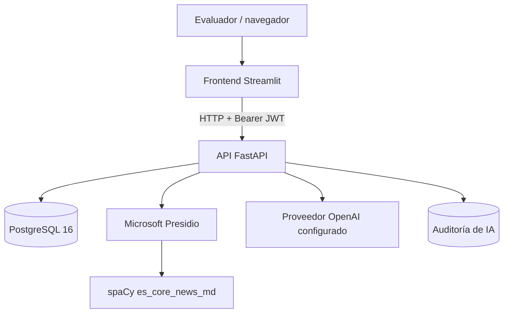

# Inventario técnico del proyecto

> Inventario interno del estado del MVP. Elaborado a partir del código fuente,
> manifiestos, migraciones, pruebas y configuración disponible en el
> repositorio. Los conteos de pruebas y cobertura indicados como reportados
> deben confirmarse en CI cuando se requiera una cifra oficial.

## 1. Visión general

**Nombre:** PQRS Intelligent System.

**Problema:** Las peticiones, quejas, reclamos y solicitudes pueden perderse,
clasificarse incorrectamente o llegar a un área equivocada. Esto aumenta el
riesgo de incumplir los plazos de atención de la Ley 1755 de 2015 y deteriora
la experiencia del ciudadano.

**Hipótesis del MVP:** Un motor de triaje automático puede clasificar y enrutar
una PQRS con una intervención humana mínima, conservar una justificación
auditable, calcular un SLA legal y mantener un comportamiento seguro cuando el
proveedor de IA no está disponible. El texto enviado al proveedor externo se
sanitiza previamente para reducir la exposición de PII.

El flujo principal implementado es:

1. Recibir la solicitud y los datos del ciudadano.
2. Persistir la PQRS y reutilizar el ciudadano cuando corresponde.
3. Sanitizar el texto.
4. Intentar clasificación con OpenAI.
5. Aplicar heurística local o fallback fijo si la IA falla.
6. Resolver el área, prioridad, tipo y SLA.
7. Persistir la auditoría y los intentos fallidos.
8. Exponer listado, alertas, estadísticas y auditoría al funcionario.

## 2. Stack tecnológico

| Capa | Tecnología | Versión o referencia configurada |
|---|---|---|
| Backend HTTP | FastAPI | `>=0.110,<1.0` |
| Servidor ASGI | Uvicorn | `>=0.28,<1.0` |
| ORM | SQLAlchemy | `>=2.0.28,<3.0` |
| Validación y esquemas | Pydantic | `>=2.6,<3.0` |
| Configuración | pydantic-settings | `>=2.2,<3.0` |
| Base de datos | PostgreSQL | 16, imagen `postgres:16-alpine` |
| Driver PostgreSQL | psycopg | `>=3.1,<4.0` |
| Migraciones | Alembic | `>=1.13.1,<2.0` |
| Clasificación | OpenAI Python SDK + Structured Outputs | Modelo configurado por `AI_MODEL_NAME`; Compose usa `gpt-6-luna` |
| NLP/PII | Microsoft Presidio + spaCy | Modelo `es_core_news_md` |
| Autenticación | PyJWT + passlib/bcrypt | PyJWT `>=2.8`; bcrypt `>=4,<5` |
| Resiliencia | tenacity | `>=8.2` |
| Calendario legal | holidays-co-full | `>=1.1` |
| Frontend | Streamlit + httpx + pandas | Dependencias en `frontend/requirements.txt` |
| Contenedores | Docker + Docker Compose | API y PostgreSQL |
| CI | GitHub Actions | Python 3.12, PostgreSQL 16 |
| Pruebas | pytest, pytest-cov, pytest-mock | Dependencias de desarrollo del backend |

Las restricciones de seguridad para dependencias transitivas están en
`backend/constraints.txt` e incluyen `msgpack`, `urllib3` y `setuptools`.

## 3. Funcionalidades por historia de usuario

| HU | Descripción | Archivos clave | Cobertura |
|---|---|---|---|
| HU-07 | Clasificación del área responsable mediante IA, resolución contra el catálogo y área predeterminada segura | `backend/app/services/classifier.py`, `backend/app/services/area_service.py`, `backend/app/schemas/classification.py` | `backend/tests/unit/test_classifier.py`, `backend/tests/unit/test_area_service.py` |
| HU-08 | Persistencia de la decisión, justificación, texto original/sanitizado, proveedor, modelo y metadata | `backend/app/models/audit.py`, `backend/app/services/audit_service.py`, `backend/app/routers/audit.py`, `backend/app/schemas/audit.py` | `backend/tests/integration/test_audit_router.py` |
| HU-09 | Cascada OpenAI con reintentos, heurística local y fallback fijo; registro de intentos fallidos | `backend/app/services/classifier.py`, `backend/app/services/heuristic_classifier.py`, `backend/app/models/audit_attempt.py`, `backend/app/services/audit_service.py` | `backend/tests/unit/test_classifier_cascade.py`, `backend/tests/unit/test_heuristic_classifier.py`, `backend/tests/integration/test_tickets_router.py` |
| HU-10 / SLA | Cálculo determinista de fechas de vencimiento en días hábiles colombianos | `backend/app/services/sla.py`, `backend/app/services/ticket_service.py` | `backend/tests/unit/test_sla.py`, `backend/tests/integration/test_sla_validation.py` |
| HU-12 | Alertas para PQRS vencidas y próximas a vencer, con exclusión de estados resueltos/cerrados | `backend/app/routers/alert.py`, `backend/app/schemas/alert.py` | `backend/tests/integration/test_alerts_router.py` |
| HU-13 | Autenticación JWT, refresh rotativo, blacklist, rate limiting y RBAC jerárquico | `backend/app/routers/auth.py`, `backend/app/core/security.py`, `backend/app/core/auth_deps.py`, `backend/app/models/funcionario.py`, `backend/app/models/refresh_token.py`, `backend/app/models/token_blacklist.py` | `backend/tests/integration/test_auth_router.py` |
| HU-14 | Listado paginado y filtrable, con visibilidad de ANALISTA limitada a su área | `backend/app/routers/ticket.py`, `backend/app/schemas/ticket.py` | `backend/tests/integration/test_tickets_list_router.py` |
| SHU-12-1 | Sanitización de nombres, emails, teléfonos y documentos colombianos con Presidio | `backend/app/services/sanitizer_service.py` | `backend/tests/unit/test_sanitizer.py` |

Además, el alta de PQRS, reutilización de ciudadanos, atomicidad de la
transacción y persistencia de auditorías están cubiertos por
`backend/tests/integration/test_tickets_router.py`. El catálogo de áreas y sus
operaciones administrativas están cubiertos por
`backend/tests/integration/test_areas_router.py`; las estadísticas por fuente,
por `backend/tests/integration/test_stats_router.py`.

## 4. Arquitectura



### Estructura principal

```text
pqrs-intelligent-system/
├── backend/
│   ├── app/
│   │   ├── core/          # configuración, DB, seguridad y dependencias auth
│   │   ├── models/        # entidades SQLAlchemy
│   │   ├── routers/       # auth, PQRS, áreas, auditoría, stats, alertas, health
│   │   ├── schemas/       # contratos Pydantic
│   │   └── services/      # clasificación, sanitización, SLA, persistencia
│   ├── alembic/versions/  # 9 migraciones
│   ├── tests/             # pruebas unitarias e integración
│   ├── scripts/           # bootstrap de MASTER
│   ├── Dockerfile
│   ├── requirements.txt
│   └── constraints.txt
├── frontend/
│   ├── app.py
│   ├── requirements.txt
│   └── README.md
├── docker-compose.yml
├── PROJECT_INVENTORY.md
└── .github/workflows/test.yml
```

`backend/app/main.py` registra los routers con `/api/v1` para PQRS, áreas,
auditoría, estadísticas y alertas. Autenticación usa el prefijo independiente
`/api/auth`; health usa `/health`.

## 5. Endpoints REST implementados

> La columna **Auth** refleja las dependencias reales de los routers. Los
> routers de PQRS y áreas tienen `Depends(get_current_user)` a nivel global.

| Método | Endpoint | Descripción | Auth |
|---|---|---|---|
| POST | `/api/v1/pqrs/` | Crea una PQRS, sanitiza, clasifica, enruta, calcula SLA y persiste auditoría | Sí |
| POST | `/api/v1/pqrs/classify-poc` | Clasificación aislada para pruebas de concepto | Sí |
| GET | `/api/v1/pqrs/` | Lista PQRS; filtros por tipo, estado, área, prioridad, SLA; paginación | Sí |
| PATCH | `/api/v1/pqrs/{tracking_number}/tipo` | Cambia tipo y recalcula SLA; registra cambio | Sí |
| GET | `/api/v1/pqrs/alerts` | Lista alertas `OVERDUE` y `DUE_SOON`, con filtro y paginación | Sí |
| GET | `/api/v1/pqrs/stats` | Estadísticas de auditorías por fuente, globales y últimas 24 horas | Sí |
| GET | `/api/v1/pqrs/{tracking_number}/audit` | Devuelve auditoría de IA de una PQRS | Sí |
| GET | `/api/v1/areas/` | Lista áreas activas/sembradas | Sí |
| GET | `/api/v1/areas/{area_id}` | Consulta un área | Sí |
| POST | `/api/v1/areas/` | Crea un área | Sí, MASTER |
| PATCH | `/api/v1/areas/{area_id}` | Actualiza un área | Sí, MASTER |
| POST | `/api/auth/login` | Valida credenciales y emite access/refresh token | No |
| POST | `/api/auth/refresh` | Rota refresh token y emite un nuevo par | No |
| POST | `/api/auth/logout` | Revoca access token y marca refresh token como usado | Sí |
| GET | `/api/auth/me` | Devuelve el funcionario autenticado | Sí |
| POST | `/api/auth/funcionarios` | Crea un funcionario sujeto a reglas de rol/área | Sí, MASTER |
| GET | `/health` | Healthcheck HTTP de la API | No |
| GET | `/` | Comprueba disponibilidad general de la API | No |

## 6. Modelo de datos

El código contiene **10 tablas SQLAlchemy**:

| Tabla | Propósito y relaciones principales |
|---|---|
| `tickets` | PQRS: radicado, texto original, tipo, prioridad, estado, área, fechas de radicación/vencimiento y bandera de validación SLA. Pertenece a un `claimant` y puede tener una auditoría IA, intentos y cambios. |
| `areas` | Catálogo de áreas con código, nombre, email del manager, estado activo y bandera `is_default`. |
| `claimants` | Ciudadanos; documento único, nombre, email y teléfono. Un ciudadano puede tener varios tickets. |
| `ai_audits` | Relación 1-a-1 con `tickets`; decisión sugerida, justificación, textos, proveedor/modelo, fuente, tokens, latencia, confianza y respuesta cruda JSONB. |
| `ai_audit_attempts` | Historial de intentos fallidos de clasificación asociado a un ticket. |
| `change_audits` | Historial de cambios manuales de clasificación, responsable, motivo y valores anterior/nuevo. |
| `funcionarios` | Usuarios del panel con `MASTER`, `SUPERVISOR` o `ANALISTA`; ANALISTA puede estar ligado a un área. |
| `refresh_tokens` | Refresh tokens almacenados como hash, con expiración, uso y `family_id` para rotación/reuso. |
| `token_blacklist` | JTI de access tokens revocados y fecha de expiración. |
| `login_attempts` | Intentos exitosos/fallidos usados para rate limiting por usuario. |

Enums funcionales:

- Tipos: `PETITION`, `COMPLAINT`, `CLAIM`, `SUGGESTION`,
  `INFORMATION_REQUEST`, `CONSULTATION`.
- Prioridades: `HIGH`, `MEDIUM`, `LOW`.
- Estados: `RECEIVED`, `IN_PROGRESS`, `RESOLVED`, `CLOSED`.
- Niveles de alerta: `OVERDUE`, `DUE_SOON`, `NORMAL`, `NO_DUE_DATE`.

La migración `152499059c9e_rename_departments_to_areas_and_seed.py` siembra el
catálogo de áreas; el código de clasificación define 10 códigos de área,
incluyendo `ATENCION_USUARIO`.

## 7. Seguridad implementada

- **Access JWT:** firmado con el algoritmo configurado, expiración por defecto
  de 60 minutos en Compose, `sub`, rol, `jti` y tipo de token.
- **Refresh rotativo:** duración configurada de 7 días; cada uso marca el token
  anterior como usado. El reuso invalida la familia (`family_id`).
- **Blacklist:** logout registra el JTI del access token hasta su expiración.
- **Rate limiting:** cinco intentos fallidos por username en una ventana de
  cinco minutos producen `429`.
- **RBAC:** niveles `MASTER > SUPERVISOR > ANALISTA`; la creación de
  funcionarios requiere MASTER.
- **Visibilidad por área:** un ANALISTA solo lista y modifica tickets de su
  área.
- **Contraseñas:** passlib con bcrypt.
- **Sanitización:** Presidio analiza español con spaCy y reemplaza email,
  teléfono, nombre y documento por marcadores como `[MASKED_EMAIL]`,
  `[MASKED_PHONE]`, `[MASKED_NAME]` y `[MASKED_DOCUMENT]`.
- **Fallback de sanitización:** ante una excepción, se registra el error y se
  devuelve el texto original; este comportamiento está explícitamente
  implementado y debe considerarse al evaluar el riesgo operativo.
- **Contenedor:** runtime con usuario no root `appuser`, `tini`, `curl` y
  healthcheck.
- **Dependencias:** `constraints.txt` fija mínimos de seguridad para
  dependencias transitivas.

## 8. Frontend Streamlit

Archivo principal: `frontend/app.py`.

- **Autenticación:** formulario de usuario/contraseña, persistencia del par
  token en `st.session_state`, consulta de `/api/auth/me`, logout y limpieza de
  sesión.
- **Dashboard:** total de PQRS, vencidas, próximas a vencer y gráfico de
  distribución `openai`/`heuristic`/`fallback`.
- **Listado:** tabla paginada con tipo, prioridad, estado, área, vencimiento y
  creación; filtros por tipo, estado, prioridad y área.
- **Detalle:** selección explícita de radicado, datos del ticket, área,
  manager, auditoría, justificación, textos original/sanitizado y metadata.
- **Creación:** formulario de ciudadano y texto libre dentro de `st.form`,
  validaciones locales, datos de ejemplo, POST de creación y consulta de
  auditoría posterior.
- **Alertas:** filtro por `OVERDUE`/`DUE_SOON` y colores visuales.
- **Presentación:** tabs Dashboard, Listado, Alertas y Crear PQRS; CSS mínimo,
  columnas, expanders y colores por prioridad/alerta.
- **Errores:** mensajes con `st.error`, tratamiento de 401 con limpieza de
  sesión y sin mostrar tracebacks.
- **Configuración:** `API_BASE_URL` configurable por entorno; predeterminado
  `http://localhost:8000`.

## 9. Infraestructura y calidad

### Docker Compose

`docker-compose.yml` define:

- `db`: PostgreSQL 16 Alpine, volumen persistente y healthcheck con
  `pg_isready`.
- `api`: imagen construida desde `backend/Dockerfile`, espera a la base
  saludable, aplica `alembic upgrade head` y arranca Uvicorn con dos workers.
- Variables de entorno para base de datos, proveedor/modelo de IA y secretos
  JWT; las claves sensibles se inyectan desde el entorno.

### Imagen de API

`backend/Dockerfile` usa dos etapas:

1. `builder`: Python 3.12 slim, herramientas de compilación, entorno virtual,
   dependencias, actualización de herramientas y descarga de
   `es_core_news_md`.
2. `runtime`: Python 3.12 slim, librerías mínimas, entorno virtual copiado,
   usuario no root, `tini`, healthcheck y Uvicorn.

### CI/CD

`.github/workflows/test.yml` contiene:

- Job `test`: PostgreSQL 16 como servicio, Python 3.12, instalación de
  dependencias de desarrollo, descarga del modelo spaCy, migraciones, pytest y
  reporte de cobertura para Codecov.
- Job `docker-build`: construcción de la imagen con Buildx y smoke test de
  `/` y `/health`.

### Migraciones

Actualmente hay **9 archivos de migración**:

1. Esquema inicial de tickets.
2. Funcionarios.
3. Renombrado de departamentos a áreas y datos semilla.
4. Texto original/sanitizado en auditoría.
5. Ajuste de clave primaria de áreas.
6. Tablas de tokens y autenticación.
7. Índices para filtros de tickets.
8. Tipos de ticket y validación SLA.
9. Intentos de auditoría IA y cambios relacionados.

### Pruebas

La suite está separada en:

- **Unitarias:** clasificador, cascada, heurística, sanitizador, SLA y
  resolución de áreas.
- **Integración:** tickets, listado, auditoría, alertas, estadísticas, áreas,
  autenticación y validación SLA.

El estado de trabajo reporta **99 pruebas pasando** y una cobertura aproximada
de **85% en servicios críticos**. En el entorno de elaboración de este
inventario, el comando `pytest` no estaba disponible en el PATH, por lo que
esas dos cifras no se reejecutaron localmente en esta sesión.

## 10. Métricas técnicas

| Métrica | Estado observado |
|---|---|
| Backend | Aproximadamente 5.000 líneas, según el contexto del proyecto |
| Frontend | Aproximadamente 667 líneas en `frontend/app.py` al momento del inventario |
| Endpoints | 18 rutas explícitas, incluyendo `/`, health, CRUD de áreas, clasificación POC y cambio de tipo |
| Tablas SQLAlchemy | 10 |
| Migraciones | 9 archivos |
| Pruebas | 99 pasando, reportadas por el estado del proyecto |
| Cobertura | Aproximadamente 85% en servicios críticos, reportada |
| Historias listadas | HU-07, HU-08, HU-09, HU-10/SLA, HU-12, HU-13, HU-14 y SHU-12-1 |

Los conteos de líneas son aproximados y no sustituyen una medición generada
por `cloc` o una herramienta equivalente.

## 11. Decisiones arquitectónicas

1. **Cascada de clasificación:** OpenAI con Structured Outputs, después
   heurística local por palabras clave y finalmente una clasificación fija
   `PETITION`/`MEDIUM`/`ATENCION_USUARIO`. La creación no se bloquea por una
   falla del LLM.
2. **Sanitización antes de IA:** la clasificación recibe el texto sanitizado,
   mientras la auditoría conserva ambos textos para trazabilidad.
3. **Resolución contra catálogo:** códigos inexistentes, inactivos o el área
   predeterminada se resuelven de forma segura al área por defecto.
4. **SLA determinista:** los plazos se calculan fuera del LLM usando días
   hábiles colombianos; `CONSULTATION` queda sin fecha y requiere validación
   humana.
5. **Auditoría persistente:** se almacena la decisión, justificación, fuente,
   metadata y errores de intentos para permitir revisión posterior.
6. **RBAC jerárquico y alcance por área:** el backend aplica permisos y limita
   la visibilidad de ANALISTA.
7. **Docker multi-stage y no root:** reduce tamaño/superficie del runtime y
   separa dependencias de construcción.
8. **Streamlit para el MVP:** prioriza demostrabilidad del motor, integración
   rápida y navegación funcional sobre una arquitectura frontend de
   producción.

## 12. Repositorio

**Repositorio:** [Sagamo-max/pqrs-intelligent-system](https://github.com/Sagamo-max/pqrs-intelligent-system)

Incluye:

- Código backend y frontend.
- Pruebas unitarias e integración.
- Dockerfile y Docker Compose.
- Migraciones Alembic.
- Workflow de CI.
- README del proyecto y documentación específica del backend/frontend.
- Script `backend/scripts/create_master.py` para bootstrap del usuario MASTER.

## 13. Evidencia del flujo completo

El flujo reportado para la demostración del MVP es:

1. Login como funcionario MASTER y recepción de `access_token`.
2. Creación de una PQRS de facturación.
3. Clasificación esperada como `CLAIM`, prioridad `HIGH` y área
   `FACTURACION` cuando el proveedor devuelve esa decisión.
4. Sanitización de nombre, documento/email y otros identificadores antes de
   clasificar.
5. Persistencia de `decision_justification` en `ai_audits`.
6. Consulta del listado desde el frontend con filtros.
7. Consulta de alertas vencidas o próximas a vencer.
8. Consulta del detalle y auditoría de IA.
9. Logout con blacklist del access token y consumo invalidado de refresh token.

La salida exacta de clasificación depende del proveedor configurado; si OpenAI
no está disponible, la evidencia debe identificar si se utilizó `heuristic` o
`fallback`.
